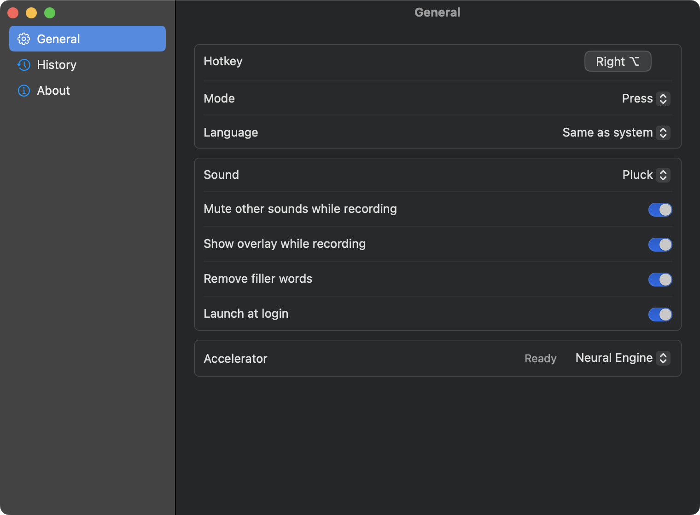
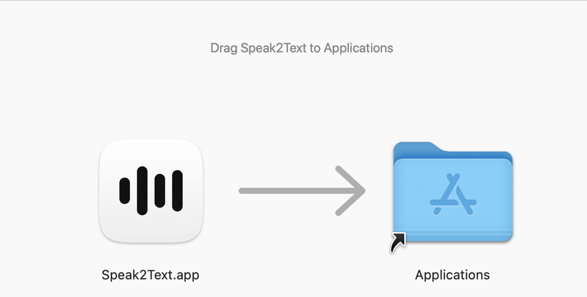
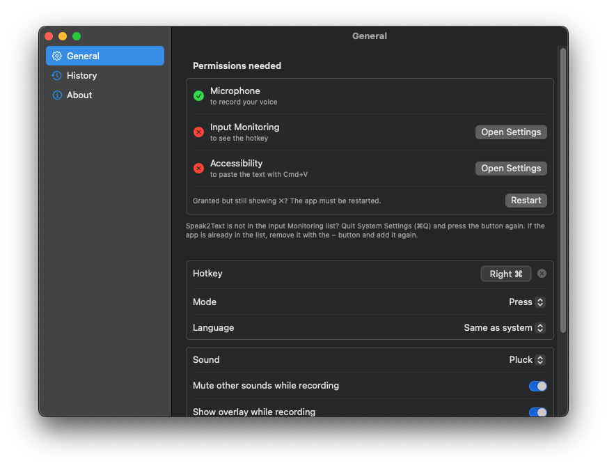
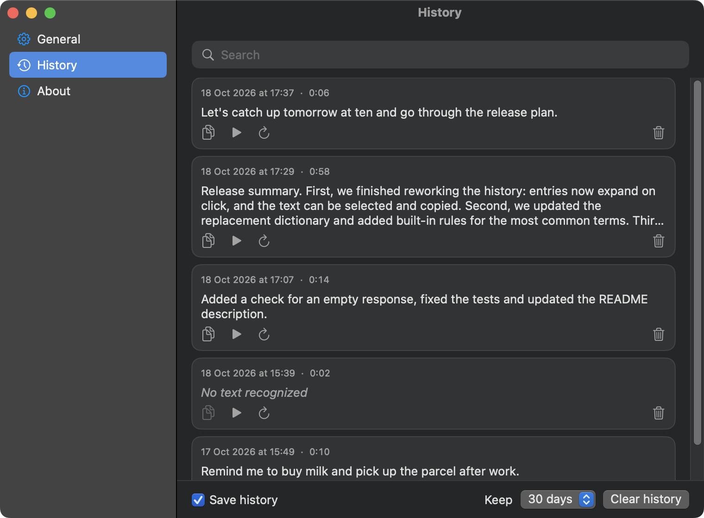
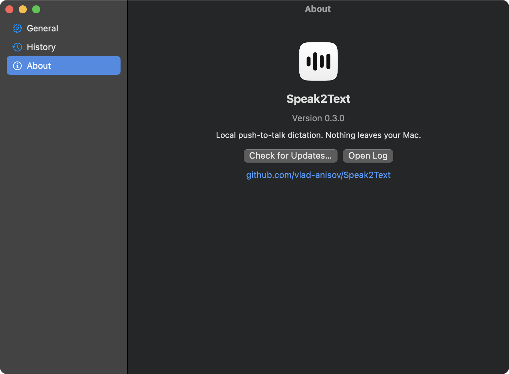

<div align="center">


# Speak2Text

**Local push-to-talk dictation for macOS. Press a key, speak, get text.**

### [⬇ Download for Mac](https://github.com/vlad-anisov/Speak2Text/releases/latest/download/Speak2Text.dmg)

macOS 14+ · Apple Silicon · free · MIT


[](LICENSE)
[](https://github.com/vlad-anisov/Speak2Text/releases/latest)

<picture>
  <source media="(prefers-color-scheme: dark)" srcset="docs/screenshots/settings-general.png">
  <source media="(prefers-color-scheme: light)" srcset="docs/screenshots/light/settings-general.png">
  
</picture>

</div>

Press a key, say what you want to write, press it again: the text appears in the app you were using. Recognition runs fully on your Mac with [WhisperKit](https://github.com/argmaxinc/WhisperKit) (Core ML), nothing is sent anywhere. Speak2Text lives in the menu bar (no Dock icon); click its icon to open the settings.

## Features

- Works offline: on-device Whisper large-v3 turbo model (632 MB) on the Neural Engine
- Live mode: partial results while you talk, final text about 0.6-1.05 s after you stop (measured)
- Any hotkey: a single left/right modifier, any key or a combination; press-to-toggle or hold-to-talk
- Small pill on screen shows the state: listening, processing, done
- 10 start/stop sounds to choose from (or none); other audio is muted while you record
- Fixes English tech terms that Whisper writes in Cyrillic (GitHub, pipeline, Jira, ...); filler words ("um", "ну") are removed by default
- History of dictations with saved audio: search, copy, listen, re-transcribe, delete
- Menu-bar icon, launch at login, automatic updates ([Sparkle](https://sparkle-project.org))
- English and Russian interface (follows macOS); all Whisper languages for recognition

## Install

1. **[Download Speak2Text.dmg](https://github.com/vlad-anisov/Speak2Text/releases/latest/download/Speak2Text.dmg)**, open it and drag **Speak2Text** onto **Applications**.

   

2. Open Speak2Text from Applications. The first time macOS says it cannot verify the app (it is not notarized): open **System Settings → Privacy & Security**, scroll down and click **Open Anyway**.
3. Allow the three permissions listed at the top of the settings window. The block disappears when everything is granted.

   <picture>
     <source media="(prefers-color-scheme: dark)" srcset="docs/screenshots/settings-general-permissions.png">
     <source media="(prefers-color-scheme: light)" srcset="docs/screenshots/light/settings-general-permissions.png">
     
   </picture>

   - **Microphone**: to record your voice
   - **Input Monitoring**: to see the hotkey
   - **Accessibility**: to paste the text into the active app
4. Wait until the status next to **Accelerator** says **Ready**. The first launch downloads the speech model (632 MB, once) and prepares it for the Neural Engine, which takes a few minutes; later launches take seconds. Keep the app running meanwhile.

That's it: press **Right Option**, speak, press it again.

<details>
<summary>For developers and advanced users</summary>

### Skip the Gatekeeper dialog from Terminal

```sh
xattr -dr com.apple.quarantine /Applications/Speak2Text.app
```

### Files

- History: `~/Library/Application Support/Speak2Text/History/` (`<id>.json` plus audio as 16 kHz mono wav)
- Log: `~/Library/Logs/Speak2Text/speak2text.log`

### Build from source

Only the Xcode Command Line Tools are needed (Swift 6.1+).

```sh
./build.sh                 # builds, signs and installs ~/Applications/Speak2Text.app
S2T_NO_INSTALL=1 ./build.sh  # build only, into build/
S2T_IDENTITY="Developer ID Application: ..." ./build.sh   # custom signing identity
```

Test recognition without a microphone:

```sh
Speak2Text --file sample.wav     # prints the text and final_wait (delay after the end of audio)
```

Regenerate the start/stop sounds with `python3 scripts/make_sounds.py`. See [docs/SPEC.md](docs/SPEC.md) for the detailed spec.

### Releasing

`scripts/release.sh <version>` builds, zips into `dist/`, generates a signed Sparkle `appcast.xml` and a drag-to-Applications `Speak2Text-<version>.dmg` (plus an unversioned copy `Speak2Text.dmg`, which the Download link below points to) (via [dmgbuild](https://github.com/dmgbuild/dmgbuild), installed into a venv under `.build/`). It publishes nothing: create the release `v<version>` on GitHub and attach both `.dmg` files (for people), the `.zip` and `.delta` files (for Sparkle updates) and `dist/appcast.xml`. Signing keys come from Sparkle `generate_keys` (private key in your Keychain, public key in `Info.plist` as `SUPublicEDKey`).

</details>

## Usage

- The default hotkey is **Right Option**. Change it in Settings → General: click the key chip and press any key, modifier or combination (Esc cancels, ⓧ resets).
- Default mode is **Press**: press to start, press again to stop (Esc cancels). **Hold** records only while the key is down.
- Language: "Same as system" (default; falls back to auto-detect if the system language is not supported), "Auto-detect" or any Whisper language.
- Right-click the menu bar icon for Settings and Quit.
- The text is pasted with Cmd+V; your previous clipboard contents are restored right after.
- History keeps dictations forever, 30 days (default), 7 days or 1 day, or can be turned off. Each entry has buttons to copy the text, listen to the recording, re-transcribe it or delete it.

## Screenshots

<p align="center">
<picture>
  <source media="(prefers-color-scheme: dark)" srcset="docs/screenshots/settings-general.png">
  <source media="(prefers-color-scheme: light)" srcset="docs/screenshots/light/settings-general.png">
  
</picture>
</p>

<p align="center">
<picture>
  <source media="(prefers-color-scheme: dark)" srcset="docs/screenshots/settings-history.png">
  <source media="(prefers-color-scheme: light)" srcset="docs/screenshots/light/settings-history.png">
  
</picture>
</p>

<p align="center">
<picture>
  <source media="(prefers-color-scheme: dark)" srcset="docs/screenshots/settings-about.png">
  <source media="(prefers-color-scheme: light)" srcset="docs/screenshots/light/settings-about.png">
  
</picture>
</p>

## Privacy

Nothing leaves your Mac. Speech recognition, history and settings are all local. The model is downloaded once from Hugging Face by WhisperKit; the only other network use is Sparkle checking for updates.

## Credits

- [WhisperKit](https://github.com/argmaxinc/WhisperKit) by Argmax: on-device speech recognition
- [Sparkle](https://sparkle-project.org): auto-updates
- [OpenAI Whisper](https://github.com/openai/whisper) models

## License

[MIT](LICENSE) © 2026 Uladzislau Anisau
